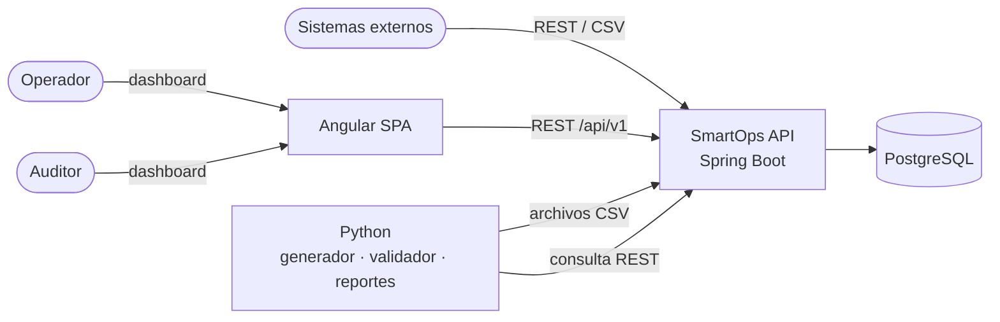
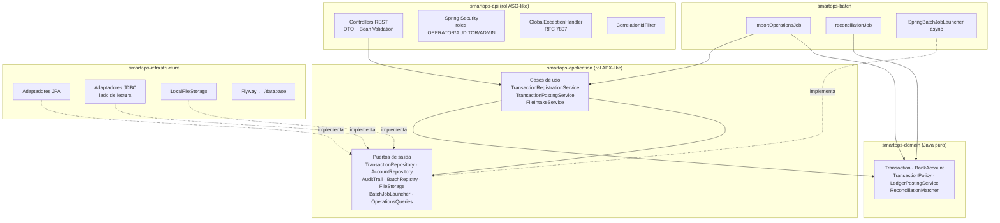
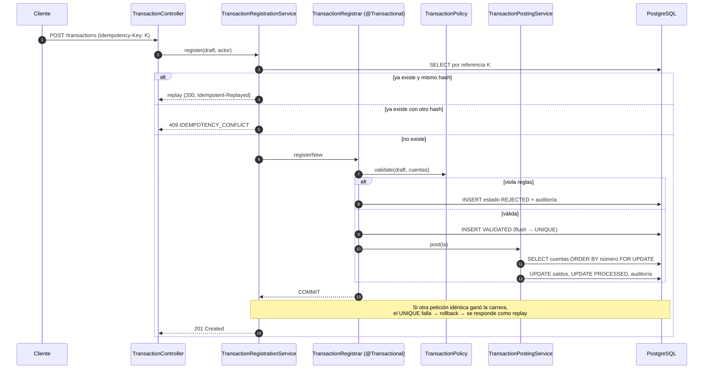
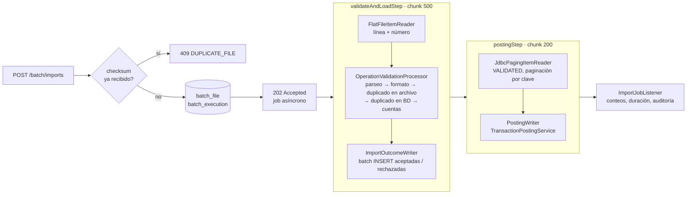
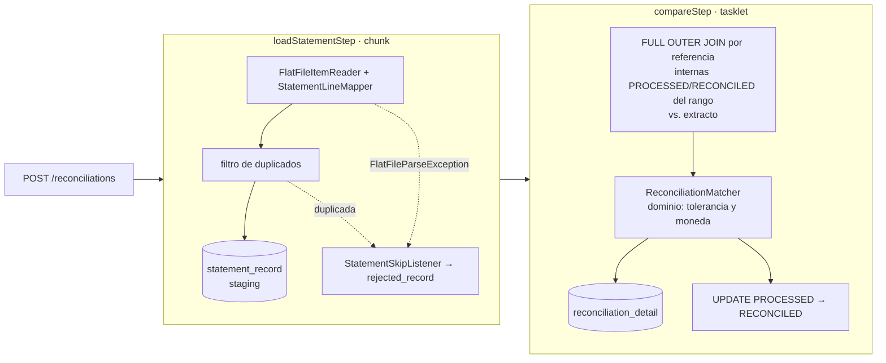
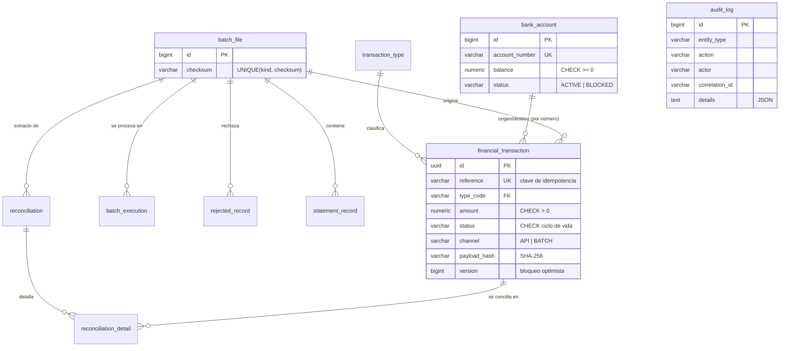
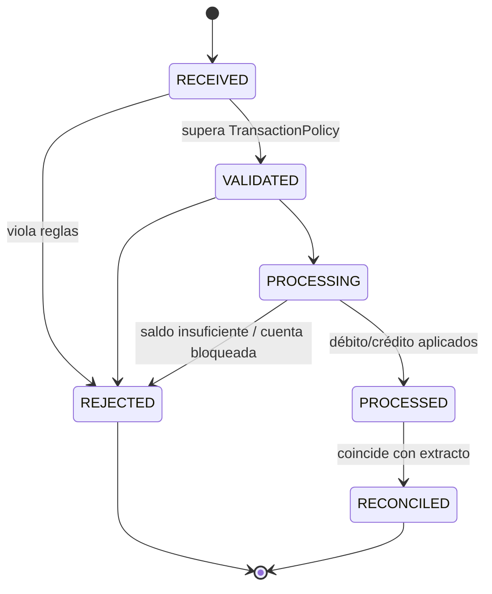

# Arquitectura de SmartOps

## 1. Vista de contexto

## 2. Vista de componentes (monolito modular)

Las dependencias entre módulos apuntan siempre hacia el dominio. Maven impide en compilación que el
dominio importe Spring o que la aplicación importe JPA.

| Módulo | Depende de | No puede depender de |
|---|---|---|
| domain | — | Spring, JPA, Web |
| application | domain, spring-context, spring-tx | JPA, Web, Batch |
| infrastructure | application | Web, Batch |
| batch | application | Web, infrastructure |
| api | todos (ensambla la aplicación) | — |

## 3. Registro idempotente de una operación (API)

## 4. Procesamiento masivo

Decisiones relevantes:

* **Rechazo como dato, no como excepción.** Un registro inválido es un resultado esperado del negocio:
  el procesador devuelve `Rejected` y el writer lo persiste con su línea y motivo. El lote nunca se
  detiene por datos malos.
* **Skip solo para lo excepcional.** Si una referencia aceptada choca en el `INSERT` porque el canal API
  la registró entre la validación y la escritura, Spring Batch omite ese ítem (`skip(DuplicateKeyException)`)
  y el `ImportSkipListener` lo registra como `DUPLICATE_REFERENCE`.
* **Reintentos controlados** (`retry(TransientDataAccessException)`, límite 3) para bloqueos y timeouts.
  Como el procesador tiene estado, se usa `processorNonTransactional()` para que un reintento reutilice
  su salida en vez de reevaluar las líneas (que se marcarían como duplicadas).
* **Paginación por clave** en `postingStep`: cada página cambia el estado de sus filas, de modo que
  un `OFFSET` saltaría registros; `WHERE id > :último` no.
* **Mismo servicio de contabilización** que el canal API (`TransactionPostingService`): una única
  implementación de las reglas contables, probada una vez.

## 5. Conciliación

PostgreSQL hace el emparejamiento (es lo que mejor hace, con índices) y el dominio hace la
clasificación, para que la regla de negocio viva en un solo lugar con pruebas unitarias.

## 6. Modelo de datos

`audit_log` es de solo inserción: un trigger rechaza cualquier `UPDATE` o `DELETE`.

## 7. Ciclo de vida de una operación

La máquina de estados está en el dominio (`TransactionStatus`) y se refuerza en la base de datos con
`CHECK` sobre los valores; el paso a `RECONCILED` por SQL masivo usa la guarda `WHERE status = 'PROCESSED'`.
